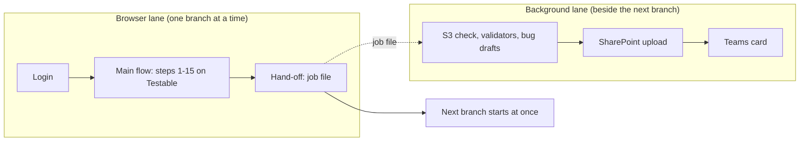

# Testable Whitebox Automation (merge-flow)

Runs a branch on the **Testable** platform with a real browser (Playwright), then checks the evidence the platform wrote to **AWS S3**, and delivers the result to **SharePoint** and **Teams**.

For every branch link you give it, it:

1. runs the 15-step whitebox flow on Testable (connect repo, pick branch, execute, wait, collect the report),
2. checks every tool's folder in S3 and judges it `PASS` / `EMPTY` / `FAIL`, with per-language validators (Python, JavaScript, TypeScript, C#, Java),
3. writes **bug drafts** (PDF, screenshot, Jira text) for platform defects. Nothing is sent to Jira automatically,
4. uploads the whole branch folder to SharePoint and posts a card in Teams.

> The full illustrated guide is **[Workflow_Guide_dev_branch.pdf](Workflow_Guide_dev_branch.pdf)**: diagrams, every step, the file map and the `.env` reference.

## How it works



When a branch passes, the browser lane writes a job file and **starts the next branch immediately**. A separate background worker does the S3 check, SharePoint upload and Teams message for the finished branch, so the platform is not left idle waiting for reports. The worker's log lines are copied into the test output as `[post] [branch] ...`.

## Quick start

Requirements: Node.js 22, Git, a Testable account, and AWS keys for the `QA-S3-Readonly` role.

```bash
git checkout dev
npm install
npx playwright install chromium
cp .env.example .env      # PowerShell: Copy-Item .env.example .env, then fill it in (see below)
npm run sp:login          # once: sign in to SharePoint with your Microsoft work account
```

Run branches (PowerShell):

```powershell
$env:BRANCHES="https://github.com/OWNER/REPO/tree/BRANCH1,https://github.com/OWNER/REPO/tree/BRANCH2"
npm test
```

Or put `{ "branches": ["link1", "link2"] }` in `builds.json` and run the `flow` project from the Test Explorer (turn on *Show browser*). Run `git checkout builds.json` afterwards so your list is not committed.

When the last test, **Background post-processing finishes**, turns green, everything is done.

## Commands

| Command | What it does |
|---|---|
| `npm test` | Full run: login, every branch, logout, wait for the worker |
| `npm run setup` | Only the Testable login (checks your credentials) |
| `npm run sp:login` | One-time SharePoint sign-in |
| `npm run post -- "<branch folder>" --repo owner/name` | Redo S3 check, bug drafts, SharePoint and Teams for one finished branch (after a network problem or expired keys) |
| `npm run s3` | Old way: re-check S3 for a results folder (`S3_RESULTS_DIR`, `S3_FORCE=1`) |
| `npm run queue` | Optional team branch queue (page on `http://localhost:3000`) |

## Settings (`.env`)

Copy `.env.example` to `.env`. Values in `.env` always win over terminal variables. Never commit it.

| Variable | Needed | Meaning |
|---|---|---|
| `TEST_ENV` | yes | `qa` (default) or `dev` |
| `TESTABLE_EMAIL`, `TESTABLE_PASSWORD` | yes | Testable login (`..._DEV` variants for `TEST_ENV=dev`) |
| `AWS_ACCESS_KEY_ID`, `AWS_SECRET_ACCESS_KEY`, `AWS_SESSION_TOKEN` | for the S3 check | Temporary keys, expire after hours to about a day |
| `TEAMS_WEBHOOK_URL` | optional | Teams channel webhook; empty = no Teams messages |
| `POSTPROCESS` | optional | `background` (default) or `inline` (everything inside the test, one branch after the other) |
| `GATE_SHOTS` | optional | `on` = also screenshot every gate (values are always read) |
| `DUMMY_PR` | optional | `yes` = push a README comment commit to each branch first |
| `SP_TENANT_ID`, `SP_CLIENT_ID`, `SP_URL` | optional | SharePoint via Microsoft Graph / another target folder. Without them `npm run sp:login` is used |

The complete list (timeouts, language override, validator ignore lists, queue settings) is in the PDF guide and in `.env.example`.

## Output

Each run writes to `results/merge-flow_<date>_<time>/`, one folder per branch:

- screenshots, `ui-values.json`, `run-details.json`, the taxonomy report and `taxonomy-gate-...-with-ui-values.html` (UI value + S3 columns),
- `s3-check.json`, `s3-evidence/` (a copy of every tool file), `bugs/` (bug drafts),
- `postprocess.json`: the status of S3, SharePoint and Teams for that branch.

SharePoint copy: `Automation Evidences Dump/<DD-MM-YYYY>/<branch>` in the team library.

## Project layout

| Path | Role |
|---|---|
| `tests/` | `auth.setup.ts` (login), `merge-flow.spec.ts` (the flow per branch), `s3-evidence.spec.ts` (old re-check) |
| `pages/MergeFlowPage.ts` | Every action on the Testable site |
| `utils/` | S3 check and validators, report builder, bug drafts, background worker (`postprocess*.ts`), SharePoint (`sharepoint*.ts`), Teams |
| `queue-server/` | Optional branch queue, live output page, freeze tracker |
| `playwright.config.ts` | Projects `setup`, `flow`, `s3`; one worker, headed browser |

## Troubleshooting

Start with `<branch folder>/postprocess.json`: it says which of S3, SharePoint and Teams worked and shows the error of the one that did not. The full log is `postprocess.log` in the run folder.

| Problem | Fix |
|---|---|
| S3 step: `ExpiredToken` | Paste fresh AWS keys in `.env`, then `npm run post -- "<branch folder>"` |
| SharePoint: "sign-in expired" | `npm run sp:login` |
| Network errors (`ENOTFOUND`, `fetch failed`) | Retried automatically after 30 s, 90 s and 3 min; otherwise `npm run post` |
| Branch blocked: "Branch unavailable" | The site's repository list is out of date; run it again later |
| No `[post]` lines | `POSTPROCESS=inline` in `.env`, or `npm install` was not run |
| Run stops when you edit files | Do not edit `.env` or `playwright.config.ts` during a run (the VS Code Playwright server restarts) |
