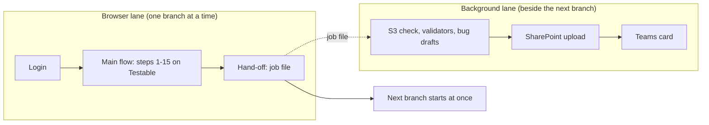

# Testable Whitebox Automation (merge-flow)

Runs a branch on the **Testable** platform with a real browser (Playwright), then checks the evidence the platform wrote to **AWS S3**, and delivers the result to **SharePoint** and **Teams**.

For every branch link you give it, it:

1. runs the 15-step whitebox flow on Testable (connect repo, pick branch, execute, wait, collect the report),
2. checks every tool's folder in S3 and judges it `PASS` / `EMPTY` / `FAIL`, with per-language validators (Python, JavaScript, TypeScript, C#, Java),
3. writes **bug drafts** (PDF, screenshot, Jira text) for platform defects. Nothing is sent to Jira automatically,
4. uploads the whole branch folder to SharePoint and posts a card in Teams.

> The full illustrated guide is **[Workflow_Guide_dev_branch.pdf](Workflow_Guide_dev_branch.pdf)**: diagrams, every step, the file map and the `.env` reference.

## How it works



When a branch passes, the browser lane writes a job file and **starts the next branch immediately**. A separate background worker does the S3 check, SharePoint upload and Teams message for the finished branch, so the platform is not left idle waiting for reports. The worker's log lines are copied into the test output as `[post] [branch] ...`.

## Quick start

Requirements: Node.js 22, Git, a Testable account, and AWS keys for the `QA-S3-Readonly` role.

```bash
git checkout dev
npm install
npx playwright install chromium
cp .env.example .env      # PowerShell: Copy-Item .env.example .env, then fill it in (see below)
npm run sp:login          # once: sign in to SharePoint with your Microsoft work account
npm run preflight         # shows what is missing (AWS keys, sign-ins, cluster) and what it would skip, before you start
```

What you do by hand: pull the branch, put the branch links in `builds.json`, fill `.env` (AWS keys, Teams webhook, Testable login), run `npm run sp:login` once, and start `npm test`. Everything after that is automatic. The AWS keys expire after a few hours: paste fresh ones before a long run.

Run branches (PowerShell):

```powershell
$env:BRANCHES="https://github.com/OWNER/REPO/tree/BRANCH1,https://github.com/OWNER/REPO/tree/BRANCH2"
npm test
```

Or put `{ "branches": ["link1", "link2"] }` in `builds.json` and run the `flow` project from the Test Explorer (turn on *Show browser*). Run `git checkout builds.json` afterwards so your list is not committed.

When the last test, **Background post-processing finishes**, turns green, everything is done.

## Commands

| Command | What it does |
|---|---|
| `npm test` | Full run: login, every branch, logout, wait for the worker |
| `npm run setup` | Only the Testable login (checks your credentials) |
| `npm run sp:login` | One-time SharePoint sign-in |
| `npm run post -- "<branch folder>" --repo owner/name` | Redo S3 check, bug drafts, SharePoint and Teams for one finished branch (after a network problem or expired keys) |
| `npm run post -- "<branch folder>" --dry-run` | Same, but nothing is uploaded or sent: prints the SharePoint copy and the Teams card (also `POST_DRYRUN=1`) |
| `npm run preflight` | Checks the setup (branch list, logins, AWS keys, SharePoint, Teams, cluster); also runs at the start of `npm test` (`PREFLIGHT=strict` stops on a FAIL) |
| `npm run eks:setup` | Check kubectl, AWS sign-in and IP for the QA EKS cluster |
| `npm run validate -- "<tool folder>"` | Validate a folder of tool results without a test run; writes `validation-report.pdf` |
| `npm run check` | Type check and unit tests (`npm run typecheck`, `npm run test:unit`); the same runs on GitHub for every push |
| `npm run s3` | Old way: re-check S3 for a results folder (`S3_RESULTS_DIR`, `S3_FORCE=1`) |
| `npm run status` | Read-only status page on `http://localhost:3100` (`STATUS_PORT` changes it): every branch of a run with its state and browser step (1-15), the background worker steps (S3, history, SharePoint, Teams), the worker log and a health strip (site, AWS keys, SharePoint sign-in, Teams, QA EKS). Start it in a second terminal; it never starts or changes a run |
| `npm run queue` | Optional team branch queue (page on `http://localhost:3000`) |

## Settings (`.env`)

Copy `.env.example` to `.env`. Values in `.env` always win over terminal variables. Never commit it.

| Variable | Needed | Meaning |
|---|---|---|
| `TEST_ENV` | yes | `qa` (default) or `dev` |
| `TESTABLE_EMAIL`, `TESTABLE_PASSWORD` | yes | Testable login (`..._DEV` variants for `TEST_ENV=dev`) |
| `AWS_ACCESS_KEY_ID`, `AWS_SECRET_ACCESS_KEY`, `AWS_SESSION_TOKEN` | for the S3 check | Temporary keys, expire after hours to about a day |
| `S3_BUCKET`, `S3_ROOT` | optional | Evidence bucket (QA default `testable-qa-artifacts-759498976252`) and the folder in front of `<tenant>/<project>/…` (default `cells/cell-001/qa/cell-001` for `TEST_ENV=qa`, `development/cell-001` for dev; set `S3_ROOT=development/cell-001` together with `S3_BUCKET=qa-bucket-us2` to read the old bucket) |
| `TEAMS_WEBHOOK_URL` | optional | Teams channel webhook; empty = no Teams messages |
| `POSTPROCESS` | optional | `background` (default) or `inline` (everything inside the test, one branch after the other) |
| `GATE_SHOTS` | optional | `on` = also screenshot every gate (values are always read) |
| `DUMMY_PR` | optional | `yes` = push a README comment commit to each branch first |
| `SP_TENANT_ID`, `SP_CLIENT_ID`, `SP_URL` | optional | SharePoint via Microsoft Graph / another target folder. Without them `npm run sp:login` is used |

The complete list (timeouts, language override, validator ignore lists, queue settings) is in the PDF guide and in `.env.example`.

## Two Testable accounts on one PC

To use a second platform account at the same time, add `TESTABLE_EMAIL_2` and `TESTABLE_PASSWORD_2` to `.env` (DEV site: `TESTABLE_EMAIL_DEV_2` / `TESTABLE_PASSWORD_DEV_2`). Then run each account in its own terminal:

```powershell
# terminal 1: the normal account
$env:BRANCHES="link1,link2"
npm test
```

```powershell
# terminal 2: the second account (set ACCOUNT in the terminal, not in .env)
$env:ACCOUNT="2"
$env:BRANCHES="link3,link4"
npm test
```

Account 2 gets its own saved session (`.auth/user-2.json`), results folder (`results/merge-flow_<date>_<time>_acct2`) and Playwright report/output folders, so the two runs never overwrite each other. Give the two terminals different branches. Without `ACCOUNT` nothing changes. Use terminals for this, not the Test Explorer.

### One command for both accounts (`npm run parallel`)

Put all branches in `builds.json` (or `BRANCHES`) and run:

```powershell
npm run parallel
```

Every account in `.env` (`TESTABLE_EMAIL`, `TESTABLE_EMAIL_2`, ...) becomes a **lane**. Each lane takes the next waiting branch, and when it finishes it takes the next one, so the branch list moves to whichever account is free. Lane 2 starts 20 seconds after lane 1 (`PARALLEL_STAGGER_SEC` changes it). Each lane keeps its own results folder (`..._acct1`, `..._acct2`), and its background worker keeps working on a finished branch while the lane already runs the next one.

- If an account cannot start two branches in a row (for example a wrong password), that lane stops and the other lane continues with the rest. A branch that did not start on one account is tried on the other.
- `LANES=1` (terminal) uses only the first account. Do not set `ACCOUNT` yourself with this command.
- The summary at the end lists every branch with its account, status and minutes; it is also saved as `results/parallel_<date>_<time>_summary.json`.
- Output lines are prefixed `[acct1]` / `[acct2]`; the background workers' lines are `[acct1 post]` / `[acct2 post]`.
- Run it from a terminal, not the Test Explorer. `npm test` and the single-account flow are unchanged.

## Tool Trigger Log in the Teams card

The Teams success card of a branch lists, for each language of the branch, **every tool** in a grid table:

| # | Tool | Triggered (earlier run) | Triggered (this run) | S3 output (earlier -> this) | Tool output |
|---|---|---|---|---|---|
| 1 | lizard | ✅ | ✅ | ✅ → ✅ | 1 file entry |
| 9 | maven-checksum | ✅ | ⚠️ | ✅ → ⚠️ | the tool reported not_applicable (...) |

✅ Output (data), ❌ Empty or Failed, ⚠️ Skipped (the tool said not applicable), ❌ Not triggered (no S3 folder), – no earlier data. The detail text comes from the validator of the language; tools that are excluded for the language version are left out. The table needs Adaptive Card 1.5 (the card version is raised only when a table is present).

- **Earlier run, from SharePoint (not from this PC):** before the Teams card the worker looks in the team folder `Automation Evidences Dump/<DD-MM-YYYY>/<branch>` (and `<branch>_RUN2`, `_RUN3`) for the newest **earlier** run of the same branch that holds tool rows, reads its `s3-check.json`, and saves the result as `previous-tools.json` in the branch folder. It works from any PC and after any number of days, as long as that run was uploaded to SharePoint with this feature (older uploads have no tool rows, so the comparison starts with the next two uploads). It needs the SharePoint sign-in (`npm run sp:login`) or Graph; without it the table has a single Triggered column and no arrow. Runs of a later day than the run being processed are ignored, and so is the run itself. When both runs are on the same day the headers show the time as well.
- **Where the rows live:** `s3-check.json` (`tools`), so `npm run post` rebuilds the card.
- **Size:** the webhook accepts about 28 KB. Long tables are shortened automatically: first the detail text, then the earlier-run columns.

## QA EKS root cause (live logs, by rules)

Why a tool gave no output is explained from the logs of the QA EKS cluster, by **rules** (known platform patterns) over **real log lines**. No model is involved. It never changes the pass/fail verdict.

**How it works**

1. During the run (steps 11 to 12) the live collector (`utils/eksCollector.ts`) saves the tool pods' console logs and the lines of the cell services about this run into `<branch folder>/eks-live/` (read only, secrets redacted; `EKS_LIVE=off` turns only this off).
2. For every tool the S3 check marks `EMPTY` / `FAIL`, the bug-draft step (`utils/eksEvidence.ts`, `utils/eksRootCause.ts`) collects the real evidence: the tool's `failure.json` from S3, the pod's exit reason and console lines, and the service lines that name exactly this tool (a planning list such as `planning.tools_unplaceable` is read for this tool's own entry).
3. A known pattern (`utils/eksRules.ts` first, then `utils/eksPatterns.ts`) answers with the real line quoted: workspace permission denied, `CELL_CPU_CAPACITY` at admission, runtime unavailable (tool not placed), tool blocked by the worker's startup check, tool skipped in planning for startup readiness, tool ran although the matrix excludes it, pod completed without a result, OOMKilled, image pull, a stuck run. No pattern: the real lines are attached (`NO_KNOWN_PATTERN`) for a person to read. No lines at all: nothing is written, never a guess. A rule is added in `eksPatterns.ts` each time the team solves a case.
4. The bug drafts (PDF and Jira text) print it as "Root-cause diagnosis (QA EKS logs)". When the S3 check fails but the capture exists, the same rules write `eks-rca/` and SharePoint and Teams still go out (the Teams card says S3 was not available).

5. **RCA Report (a separate output from the bug drafts).** After the S3 check, the worker step `rcareport` writes one readable report for every defective tool into the folder `RCA Report` of the branch folder: `RCA_<tool>.md` (in one sentence, what happened, why, evidence line, impact, who fixes it, what to do, confidence) and `index.json`. It goes to SharePoint with the branch folder (`<day>/<branch>/RCA Report`), before the copy. The words come from a local Ollama model (`rca-writer`, made once with `ollama create rca-writer -f rca-model/Modelfile`); the facts, the evidence line and the owner come from the logs and the rules. An answer that contains a path, option, version or number that is not in the facts is thrown away, and that tool gets the rule-written report; no Ollama on the PC gives the rule-written reports for every tool (`RCA_MODEL=off` does the same on purpose). By hand: `npm run rca -- "<branch folder>"`; compare base models: `npm run rca:bakeoff -- "<branch folder>"` with `RCA_BAKEOFF_MODELS=a,b,c`. No defective tool = no folder.

**Needs and limits:** the team's read-only cluster key (`EKS_AWS_ACCESS_KEY_ID` + `EKS_AWS_SECRET_ACCESS_KEY`) or your own `aws sso login --profile qa-eks-ro`. It is always on; only `EKS_AUTO=off` in `.env` switches it off. When the cluster is not reachable the capture is skipped with one line and the run continues. If the cluster was recreated with a new address, the saved kubectl context `qa-eks-ro` is refreshed from AWS automatically (needs the EKS key; with a sign-in profile run `aws eks update-kubeconfig --name qa-eks --region us-east-2 --alias qa-eks-ro` once). Cluster logs only reach back to the cluster's start, so old runs cannot be analysed; `npm run eks:history` re-checks a finished run from what the cluster still holds. Settings: `EKS_CLUSTER_NAME` (qa-eks), `EKS_REGION` (us-east-2), `EKS_KUBECTL`, `EKS_AWS_CLI`. Keep the key in `.env` only, never in the repository.

Earlier versions also wrote the explanation with a local Ollama model (`qa-eks-mentor/`). It was removed on 3 Nov 2026; it is in the git history up to commit `af4944b`.

The full flow with charts is in `Workflow_Guide_Full_Implementation.pdf` (generated by `generate_workflow_guide_full.py`).

**Validate a folder of tool results (`npm run validate -- "<folder>"`):** for a folder like what S3 holds for one run (one folder per tool, `<tool>/<id>/0/<file>.json`), for example one downloaded by hand. No test run, no AWS keys: a local reader serves the folder to the same checker as the S3 step, so the language and the tool matrix come from the folder name (`PY_V36_...`, `JV_V17_...`). Every tool that is not PASS is listed with what its own file says and, when the folder holds real evidence for it (a `failure.json`), the diagnosis of the known-pattern rules. `--repo owner/name` and `--run-id <id>` are optional. Output in `results/validate_<time>/<name>/`: **`validation-report.pdf`** (the checker's table and the tools that did not pass), the same as `validation-report.md`, `s3-check.json` and `s3-evidence/`. Only the tool files are known (no run id, no EKS logs), so a tool that never produced a folder can only be reported as not triggered.

**Pre-flight check (`npm run preflight`, also the second step of `npm test`):** before the first branch the script checks the branch list, the platform login, the AWS S3 keys (a real read), the SharePoint sign-in, the Teams webhook, and the EKS cluster. It prints OK / WARN / FAIL per line with the effect (what will be skipped) and the fix, and saves `preflight.json` in the round folder. It changes nothing and only reports; `PREFLIGHT=strict` stops the run on a FAIL, `PREFLIGHT=off` skips it.

**No duplicates, and what a round leaves behind:** a SharePoint folder of the same day that already holds the same run (same `run_id` in its `run-details.json`) is reused instead of making `_RUN2`, `_RUN3`. A complete Teams card (with the S3 result) is sent once per run; `TEAMS_RESEND=1` sends it again, and a partial card (S3 failed) is replaced by the full one. When S3 fails now, an older `s3-check.json` of that folder is kept aside as `s3-check.previous.json`. Problems that must not stop a run are written to `warnings.log` in the branch folder instead of being swallowed. `<round folder>/summary.md` holds one row per branch (language, tools, defects, post-processing steps) and is rebuilt after every branch.

**Dry run (`POST_DRYRUN=1` in `.env`, or `npm run post -- "<branch folder>" --dry-run`):** the post-processing does everything that only reads (EKS logs, S3 check, bug drafts, SharePoint history) but does not upload to SharePoint and does not send to Teams. It prints what would be copied (files, MB, target folder) and what the Teams card would contain (text, buttons, size against the 28 KB webhook limit) and saves the full card in `<round folder>/dryrun/`. Use it to test a new `.env` without filling the team's channel. It does not cover the test run itself (`DUMMY_PR=yes` still pushes a commit).

**Post-processing a run that was not executed on this PC** (`npm run post -- "<branch folder>"` with a `run-details.json`): the `eks` step looks for the run's live QA EKS capture in the team SharePoint folder (`<day>/<branch>[_RUN2…]/eks-live`, matched by run id) and downloads it into `<branch folder>/eks-live/`, so the bug drafts use the real pod logs. It needs `npm run sp:login` once and is skipped when `eks-live` is already on this PC. If the S3 step fails (usually expired AWS keys) and the run's `eks-live` capture exists, the `rca` step still writes the root causes from the QA EKS logs alone (known patterns, by rules) to `eks-rca/`, and SharePoint and Teams go out with them (the Teams card says that S3 was not available). Without an `eks-live` of that run, SharePoint and Teams are **not** sent; fix the keys and run the same command again. With valid keys the same command gives the full report.
## Output

Each run writes to `results/merge-flow_<date>_<time>/`, one folder per branch:

- screenshots, `ui-values.json`, `run-details.json`, the taxonomy report and `taxonomy-gate-...-with-ui-values.html` (UI value + S3 columns),
- `s3-check.json`, `s3-evidence/` (a copy of every tool file), `bugs/` (bug drafts),
- `postprocess.json`: the status of S3, SharePoint and Teams for that branch,
- `eks-rca/`: root causes from the QA EKS logs alone, written when the S3 check failed.

SharePoint copy: `Automation Evidences Dump/<DD-MM-YYYY>/<branch>` in the team library.

## Project layout

| Path | Role |
|---|---|
| `tests/` | `auth.setup.ts` (login), `merge-flow.spec.ts` (the flow per branch), `s3-evidence.spec.ts` (old re-check) |
| `pages/MergeFlowPage.ts` | Every action on the Testable site |
| `utils/` | S3 check and validators, report builder, bug drafts, background worker (`postprocess*.ts`), SharePoint (`sharepoint*.ts`), Teams |
| `queue-server/` | Optional branch queue, live output page, freeze tracker |
| `playwright.config.ts` | Projects `setup`, `flow`, `s3`; one worker, headed browser |

## Troubleshooting

Start with `<branch folder>/postprocess.json`: it says which of S3, SharePoint and Teams worked and shows the error of the one that did not. The full log is `postprocess.log` in the run folder.

| Problem | Fix |
|---|---|
| S3 step: `ExpiredToken` | Paste fresh AWS keys in `.env`, then `npm run post -- "<branch folder>"` |
| SharePoint: "sign-in expired" | `npm run sp:login` |
| Network errors (`ENOTFOUND`, `fetch failed`) | Retried automatically after 30 s, 90 s and 3 min; otherwise `npm run post` |
| Branch blocked: "Branch unavailable" | The site's repository list is out of date; run it again later |
| No `[post]` lines | `POSTPROCESS=inline` in `.env`, or `npm install` was not run |
| Run stops when you edit files | Do not edit `.env` or `playwright.config.ts` during a run (the VS Code Playwright server restarts) |
