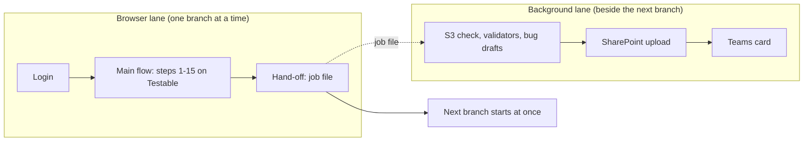

# Testable Whitebox Automation (merge-flow)

Runs a branch on the **Testable** platform with a real browser (Playwright), then checks the evidence the platform wrote to **AWS S3**, and delivers the result to **SharePoint** and **Teams**.

For every branch link you give it, it:

1. runs the 15-step whitebox flow on Testable (connect repo, pick branch, execute, wait, collect the report),
2. checks every tool's folder in S3 and judges it `PASS` / `EMPTY` / `FAIL`, with per-language validators (Python, JavaScript, TypeScript, C#, Java),
3. writes **bug drafts** (PDF, screenshot, Jira text) for platform defects. Nothing is sent to Jira automatically,
4. uploads the whole branch folder to SharePoint and posts a card in Teams.

> The full illustrated guide is **[Workflow_Guide_dev_branch.pdf](Workflow_Guide_dev_branch.pdf)**: diagrams, every step, the file map and the `.env` reference.

## How it works



When a branch passes, the browser lane writes a job file and **starts the next branch immediately**. A separate background worker does the S3 check, SharePoint upload and Teams message for the finished branch, so the platform is not left idle waiting for reports. The worker's log lines are copied into the test output as `[post] [branch] ...`.

## Quick start

Requirements: Node.js 22, Git, a Testable account, and AWS keys for the `QA-S3-Readonly` role.

```bash
git checkout dev
npm install
npx playwright install chromium
cp .env.example .env      # PowerShell: Copy-Item .env.example .env, then fill it in (see below)
npm run sp:login          # once: sign in to SharePoint with your Microsoft work account
```

Run branches (PowerShell):

```powershell
$env:BRANCHES="https://github.com/OWNER/REPO/tree/BRANCH1,https://github.com/OWNER/REPO/tree/BRANCH2"
npm test
```

Or put `{ "branches": ["link1", "link2"] }` in `builds.json` and run the `flow` project from the Test Explorer (turn on *Show browser*). Run `git checkout builds.json` afterwards so your list is not committed.

When the last test, **Background post-processing finishes**, turns green, everything is done.

## Commands

| Command | What it does |
|---|---|
| `npm test` | Full run: login, every branch, logout, wait for the worker |
| `npm run setup` | Only the Testable login (checks your credentials) |
| `npm run sp:login` | One-time SharePoint sign-in |
| `npm run post -- "<branch folder>" --repo owner/name` | Redo S3 check, bug drafts, SharePoint and Teams for one finished branch (after a network problem or expired keys) |
| `npm run s3` | Old way: re-check S3 for a results folder (`S3_RESULTS_DIR`, `S3_FORCE=1`) |
| `npm run queue` | Optional team branch queue (page on `http://localhost:3000`) |

## Settings (`.env`)

Copy `.env.example` to `.env`. Values in `.env` always win over terminal variables. Never commit it.

| Variable | Needed | Meaning |
|---|---|---|
| `TEST_ENV` | yes | `qa` (default) or `dev` |
| `TESTABLE_EMAIL`, `TESTABLE_PASSWORD` | yes | Testable login (`..._DEV` variants for `TEST_ENV=dev`) |
| `AWS_ACCESS_KEY_ID`, `AWS_SECRET_ACCESS_KEY`, `AWS_SESSION_TOKEN` | for the S3 check | Temporary keys, expire after hours to about a day |
| `S3_BUCKET`, `S3_ROOT` | optional | Evidence bucket (QA default `testable-qa-artifacts-759498976252`) and the folder in front of `<tenant>/<project>/…` (default `cells/cell-001/qa/cell-001` for `TEST_ENV=qa`, `development/cell-001` for dev; set `S3_ROOT=development/cell-001` together with `S3_BUCKET=qa-bucket-us2` to read the old bucket) |
| `TEAMS_WEBHOOK_URL` | optional | Teams channel webhook; empty = no Teams messages |
| `POSTPROCESS` | optional | `background` (default) or `inline` (everything inside the test, one branch after the other) |
| `GATE_SHOTS` | optional | `on` = also screenshot every gate (values are always read) |
| `DUMMY_PR` | optional | `yes` = push a README comment commit to each branch first |
| `SP_TENANT_ID`, `SP_CLIENT_ID`, `SP_URL` | optional | SharePoint via Microsoft Graph / another target folder. Without them `npm run sp:login` is used |

The complete list (timeouts, language override, validator ignore lists, queue settings) is in the PDF guide and in `.env.example`.

## Two Testable accounts on one PC

To use a second platform account at the same time, add `TESTABLE_EMAIL_2` and `TESTABLE_PASSWORD_2` to `.env` (DEV site: `TESTABLE_EMAIL_DEV_2` / `TESTABLE_PASSWORD_DEV_2`). Then run each account in its own terminal:

```powershell
# terminal 1: the normal account
$env:BRANCHES="link1,link2"
npm test
```

```powershell
# terminal 2: the second account (set ACCOUNT in the terminal, not in .env)
$env:ACCOUNT="2"
$env:BRANCHES="link3,link4"
npm test
```

Account 2 gets its own saved session (`.auth/user-2.json`), results folder (`results/merge-flow_<date>_<time>_acct2`) and Playwright report/output folders, so the two runs never overwrite each other. Give the two terminals different branches. Without `ACCOUNT` nothing changes. Use terminals for this, not the Test Explorer.

### One command for both accounts (`npm run parallel`)

Put all branches in `builds.json` (or `BRANCHES`) and run:

```powershell
npm run parallel
```

Every account in `.env` (`TESTABLE_EMAIL`, `TESTABLE_EMAIL_2`, ...) becomes a **lane**. Each lane takes the next waiting branch, and when it finishes it takes the next one, so the branch list moves to whichever account is free. Lane 2 starts 20 seconds after lane 1 (`PARALLEL_STAGGER_SEC` changes it). Each lane keeps its own results folder (`..._acct1`, `..._acct2`), and its background worker keeps working on a finished branch while the lane already runs the next one.

- If an account cannot start two branches in a row (for example a wrong password), that lane stops and the other lane continues with the rest. A branch that did not start on one account is tried on the other.
- `LANES=1` (terminal) uses only the first account. Do not set `ACCOUNT` yourself with this command.
- The summary at the end lists every branch with its account, status and minutes; it is also saved as `results/parallel_<date>_<time>_summary.json`.
- Output lines are prefixed `[acct1]` / `[acct2]`; the background workers' lines are `[acct1 post]` / `[acct2 post]`.
- Run it from a terminal, not the Test Explorer. `npm test` and the single-account flow are unchanged.

## Tool Trigger Log in the Teams card

The Teams success card of a branch lists, for each language of the branch, **every tool** in a grid table:

| # | Tool | Triggered (earlier run) | Triggered (this run) | S3 output (earlier -> this) | Tool output |
|---|---|---|---|---|---|
| 1 | lizard | ✅ | ✅ | ✅ → ✅ | 1 file entry |
| 9 | maven-checksum | ✅ | ⚠️ | ✅ → ⚠️ | the tool reported not_applicable (...) |

✅ Output (data), ❌ Empty or Failed, ⚠️ Skipped (the tool said not applicable), ❌ Not triggered (no S3 folder), – no earlier data. The detail text comes from the validator of the language; tools that are excluded for the language version are left out. The table needs Adaptive Card 1.5 (the card version is raised only when a table is present).

- **Earlier run, from SharePoint (not from this PC):** before the Teams card the worker looks in the team folder `Automation Evidences Dump/<DD-MM-YYYY>/<branch>` (and `<branch>_RUN2`, `_RUN3`) for the newest **earlier** run of the same branch that holds tool rows, reads its `s3-check.json`, and saves the result as `previous-tools.json` in the branch folder. It works from any PC and after any number of days, as long as that run was uploaded to SharePoint with this feature (older uploads have no tool rows, so the comparison starts with the next two uploads). It needs the SharePoint sign-in (`npm run sp:login`) or Graph; without it the table has a single Triggered column and no arrow. Runs of a later day than the run being processed are ignored, and so is the run itself. When both runs are on the same day the headers show the time as well.
- **Where the rows live:** `s3-check.json` (`tools`), so `npm run post` rebuilds the card.
- **Size:** the webhook accepts about 28 KB. Long tables are shortened automatically: first the detail text, then the earlier-run columns.

## QA EKS Mentor (why a tool failed)

A small local model (`qa-eks-mentor-trained`, Qwen2.5 3B served by Ollama) explains **why a tool gave no output**, from the logs of the QA EKS cluster. It never changes the pass/fail verdict.

**When it runs:** only for a branch that has a **platform defect** (a tool judged `EMPTY` / `FAIL` by the S3 check), at the moment the bug drafts are written, in the background worker. Branches without defects never start it. It is **off by default**; it turns on when `EKS_AWS_ACCESS_KEY_ID` + `EKS_AWS_SECRET_ACCESS_KEY` (the team's read-only cluster key) are in `.env`, or with `EKS_AUTO=on` plus your own `aws sso login --profile qa-eks-ro`. `EKS_AUTO=off` switches it off.

**How it produces the output:**
1. For each defective tool it starts `qa-eks-mentor/analyze.py` with the run id.
2. `analyze.py` reads the `kubectl logs` of the 9 `cell-001-*` services in namespace `whitebox-cell-001` (current and previous container), finds the lines of that run, applies fixed rules, and only then asks the model for a short summary.
3. It writes `Analysis_Report_<tool>-<run>.pdf` and `<tool>-<run>.md`. The files are copied into `<branch folder>/qa-eks-analysis/`, so the SharePoint upload carries them.
4. The bug drafts (PDF, HTML, Jira text) print the diagnosis **only when such a ready report exists**. Without a report nothing is printed, never a guess.

**When it is skipped (one line in the log, the run continues):** no EKS key or sign-in, `kubectl`/`aws` not on the PATH, the cluster not reachable from this PC (network / VPN), or the 8-minute limit (`EKS_ANALYZE_MIN`) reached. If the cluster was recreated with a new address, the saved kubectl context `qa-eks-ro` is refreshed from AWS automatically (needs the EKS key; with a sign-in profile run `aws eks update-kubeconfig --name qa-eks --region us-east-2 --alias qa-eks-ro` once).

**Limits:** cluster logs only reach back to the cluster's start, so old runs cannot be analysed. Settings: `EKS_CLUSTER_NAME` (qa-eks), `EKS_REGION` (us-east-2), `EKS_PYTHON`, `EKS_KUBECTL`, `EKS_AWS_CLI`, `EKS_ANALYZE_MIN`, `EKS_MENTOR_DIR`. Keep the key in `.env` only, never in the repository.

## Output

Each run writes to `results/merge-flow_<date>_<time>/`, one folder per branch:

- screenshots, `ui-values.json`, `run-details.json`, the taxonomy report and `taxonomy-gate-...-with-ui-values.html` (UI value + S3 columns),
- `s3-check.json`, `s3-evidence/` (a copy of every tool file), `bugs/` (bug drafts),
- `postprocess.json`: the status of S3, SharePoint and Teams for that branch,
- `qa-eks-analysis/`: the QA EKS Mentor reports (only when a tool had a defect and the analysis ran).

SharePoint copy: `Automation Evidences Dump/<DD-MM-YYYY>/<branch>` in the team library.

## Project layout

| Path | Role |
|---|---|
| `tests/` | `auth.setup.ts` (login), `merge-flow.spec.ts` (the flow per branch), `s3-evidence.spec.ts` (old re-check) |
| `pages/MergeFlowPage.ts` | Every action on the Testable site |
| `utils/` | S3 check and validators, report builder, bug drafts, background worker (`postprocess*.ts`), SharePoint (`sharepoint*.ts`), Teams |
| `queue-server/` | Optional branch queue, live output page, freeze tracker |
| `playwright.config.ts` | Projects `setup`, `flow`, `s3`; one worker, headed browser |

## Troubleshooting

Start with `<branch folder>/postprocess.json`: it says which of S3, SharePoint and Teams worked and shows the error of the one that did not. The full log is `postprocess.log` in the run folder.

| Problem | Fix |
|---|---|
| S3 step: `ExpiredToken` | Paste fresh AWS keys in `.env`, then `npm run post -- "<branch folder>"` |
| SharePoint: "sign-in expired" | `npm run sp:login` |
| Network errors (`ENOTFOUND`, `fetch failed`) | Retried automatically after 30 s, 90 s and 3 min; otherwise `npm run post` |
| Branch blocked: "Branch unavailable" | The site's repository list is out of date; run it again later |
| No `[post]` lines | `POSTPROCESS=inline` in `.env`, or `npm install` was not run |
| Run stops when you edit files | Do not edit `.env` or `playwright.config.ts` during a run (the VS Code Playwright server restarts) |
