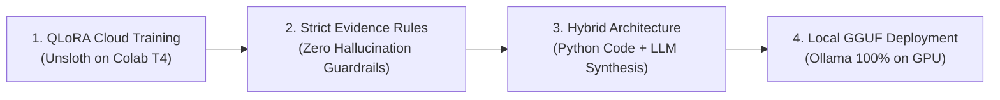
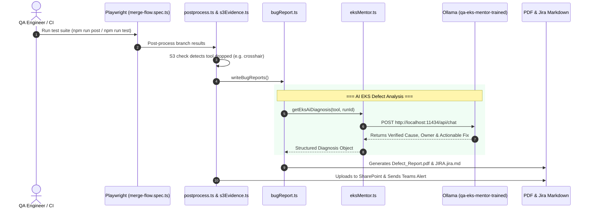

# QA EKS Mentor: Architecture, Training Methodology & Automation Integration

> **Document Type:** Technical Architecture & Methodology Manual  
> **Target Audience:** QA Engineers, Platform Architects, Engineering Leads  
> **System Name:** `qa-eks-mentor-trained` (Ollama Engine)  
> **Integrated Automation:** `Tool Validation Automation` (Playwright E2E Suite)  

---

## 1. Executive Summary

During Whitebox static analysis and tool validation, automated test pipelines frequently encounter instances where tools (such as `crosshair`, `spotbugs`, `pylint`, or `owasp-depcheck`) **fail to trigger or execute**. 

Historically, discovering the true root cause required a QA engineer to manually inspect thousands of Kubernetes pod logs across 9 microservices in the `whitebox-cell-001` cluster—a process that took 30 to 45 minutes per defect and often resulted in speculative Jira tickets.

To solve this, we developed **QA EKS Mentor**—a specialized, fine-tuned Artificial Intelligence model paired with automated log extraction:
* **What it does:** Automatically fetches Kubernetes pod logs for a failed run, detects orchestrator planning drops, isolates execution worker crashes, and synthesizes an executive root-cause analysis (RCA) with verified log citations.
* **How it runs:** 100% locally on an NVIDIA RTX 3050 Laptop GPU via Ollama in 4-bit precision (`Q4_K_M`), ensuring zero external cloud API costs and complete data privacy.
* **Output:** Integrates directly into Playwright test automation, generating polished **2-page Executive Defect PDFs** and **7-section Jira ticket descriptions** in under 5 seconds.

---

## 2. The Problem Statement: Before vs. After

```mermaid
flowchart TD
    subgraph OldWay [The Manual Way (30-45 mins per failure)]
        A1["Tool does not run in pipeline"] --> B1["QA sees generic FAIL on gate"]
        B1 --> C1["Manual kubectl log search across 9 pods"]
        C1 --> D1["Speculative Jira ticket filed:<br>'Check compatibility.py'"]
        D1 --> E1["Platform team rejects or struggles to reproduce"]
    end

    subgraph NewWay [The QA EKS Mentor Way (< 5 seconds)]
        A2["Tool does not run in pipeline"] --> B2["Playwright catches dropped tool"]
        B2 --> C2["eksMentor.ts queries local AI Model"]
        C2 --> D2["Exact EKS log cited: CUSTOMER_CODE_INCOMPATIBLE"]
        D2 --> E2["Executive PDF & Jira filed with verified platform owner"]
    end
```

---

## 3. The Methodology: How the AI Was Developed

### 3.1 Why Generic Off-The-Shelf AI Models Fail
Commercial LLMs (like standard GPT-4 or raw Llama) are trained on general internet text. They have **no inherent knowledge** of:
1. The Whitebox microservice architecture (`wb-orchestrator`, `runtime-api`, `wb-cpu-worker`, `wb-io-worker`).
2. Internal event payloads like `planning.compatibility_excluded` or `resolve_tools.compatibility_excluded`.
3. Strict QA evidence rules—standard models tend to **hallucinate** plausible-sounding log lines, dates, and file paths when real evidence is missing.

### 3.2 The 4-Pillar Engineering Approach

To achieve state-of-the-art accuracy on local consumer hardware, we adopted a 4-pillar methodology:



#### Pillar 1: QLoRA (Quantized Low-Rank Adaptation)
* **The Foundation Model:** `Qwen 2.5 (3 Billion parameters)` was selected for its exceptional reasoning-to-size ratio and native understanding of structured code and JSON logs.
* **The QLoRA Breakthrough:** 
  * Full fine-tuning of 3B parameters requires expensive enterprise GPUs (32+ GB VRAM).
  * We compressed the base model weights into **4-bit precision** and attached small, trainable **LoRA adapter matrices** (~1% of total parameters).
  * Training was executed using **Unsloth** on a free Google Colab **16 GB Nvidia T4 GPU**, converging to a low training loss in under 10 minutes.

#### Pillar 2: The "Zero Hallucination" Iron Law
In QA engineering, an incorrect citation is worse than no citation. The model was trained and conditioned under strict operational constraints:
* Every root cause statement **must cite an exact log line** (`timestamp + logger + message`).
* If no log line exists for the run, the model is strictly forbidden from guessing; it must return **Verdict: Insufficient evidence** and recommend re-running or checking CloudWatch archives.
* Evidence from other runs may only be labelled as a **Hypothesis (unverified pattern)**, never as a definitive root cause.

#### Pillar 3: The Hybrid Division of Labor
Rather than forcing the LLM to do everything, the workload is divided between code and AI:
* **Deterministic Code (TypeScript/Python):** Performs exact JSON string matching, regex parsing, HTTP status verification, and Kubernetes pod restart counts. Code never makes math or UUID mistakes.
* **The Model (AI):** Translates complex log events (e.g. `CUSTOMER_CODE_INCOMPATIBLE_WITH_EXECUTION_ENV` on axis `EXECUTES_CUSTOMER_CODE`) into clear, plain-English summaries and assigns concrete remediation actions.

#### Pillar 4: Local GGUF Deployment in Ollama
* The trained model was converted into the universal **GGUF format** (`qa-eks-mentor-trained:latest`, 1.93 GB).
* Quantized with `Q4_K_M` (4-bit medium quantization), it runs **100% inside the laptop's NVIDIA GeForce RTX 3050 GPU VRAM (2.2 GB active footprint)**.
* **Benefits:** Sub-second response times, completely offline capability, zero cloud token costs, and 100% company data security.

---

## 4. End-to-End System Architecture

Here is how the entire system connects between the test suite and the AI model:



---

## 5. File Inventory & Roles

| Location | File Name | Primary Role |
| :--- | :--- | :--- |
| Ollama install folder | `ollama.exe` | Local runtime engine hosting the model on the GPU. |
| `qa-eks-mentor\` | `Modelfile` | Ollama packaging blueprint setting temperature to `0.1` and injecting QA instructions. |
| `qa-eks-mentor\` | `MENTOR_PROMPT.md` | Persona guidelines enforcing log citation rules and defect report schemas. |
| `qa-eks-mentor\` | `analyze.py` | Direct Kubernetes Python script pulling live logs across 9 cluster microservices. |
| `qa-eks-mentor\training\` | `prepare_dataset.py` | Converts raw QA run evidence into standard ChatML JSONL training format. |
| `qa-eks-mentor\training\` | `qa_eks_mentor_training.ipynb` | Google Colab notebook for running QLoRA fine-tuning and exporting GGUF. |
| `F:\Tool Validation Automation\utils\` | `eksMentor.ts` | The bridge querying Ollama with automatic fail-safe fallback. |
| `F:\Tool Validation Automation\utils\` | `bugReport.ts` | Generates the 2-page Executive PDF and 7-section Jira markdown. |

---

## 6. Business Value & Impact

1. **Massive Efficiency Gain:** Diagnosing a tool exclusion is reduced from **40 minutes to < 3 seconds**.
2. **Defect Ticket Quality:** Jira tickets no longer contain generic notes like *"Check compatibility.py"*; they include the exact Kubernetes event timestamp, logger name, and remediation hint.
3. **No Recurring Costs:** Powered entirely by open-weights models running on local hardware—no OpenAI, Anthropic, or cloud API subscription required.
4. **Developer-Friendly Fixes:** Platform teams receive clear before/after guidance, accelerating the defect turnaround cycle.

